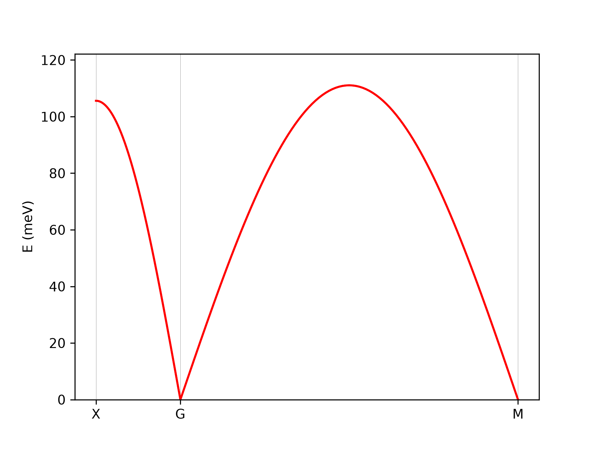

# Tutorial #2-NiO with minimum input
In this tutorial, we would like to show how to properly set up a calculation with minimum input from experimental data. We will demonstrate it on an example of NiO. We would like to see the magnon spectrum based on the exchange constants from Table II of Ref. [7]. Additionally, we want to see what its Néel temperature is, based on this data.
## Band structure calculations
&emsp;The lattice constant used in the text is $a_0\approx 4.17$ Å, the spin moment of the Ni ions in NiO is $S=1$, and the system is in a collinear antiferromagnetic state. We can write the geometry into the input file for _*OstravaMag_PrepareInput*_ as follows (we use magnetic moments, not spin moments)
```
lattice
    4.170000      2.085000      2.085000
    2.085000      4.170000      2.085000
    2.085000      2.085000      4.170000
  

atoms fractional
    Ni  0.00  0.00  0.00     0  0   2
    Ni  0.50  0.50  0.50     0  0   -2
  

exchange
    2.95   0.7
    4.17  -9.5
```
Create a directory called _*NiO_tutorial*_ and save this into a file called _*input.txt*_ inside the directory. We want to plot the band structure along the following k-path
```
100
0.5 0.5 0.5 X
0 0 0 G
  

0 0 0 G
0 0.5 0.5 M
```
Save this into _*kpath.txt*_ in the _*NiO_tutorial*_ directory. This gives us all the necessary input to run the calculation. To create the TB2J input from the plain text file and move it into the input directory, run the following command
```
OstravaMag_PrepareInput NiO_tutorial/input.txt --tol 0.01
mv TB2J.pickle NiO_tutorial/
```
The "--tol" option specifies how much the shell distances in the input file may differ from the ones calculated by the program. If we instead set it to 0.001, we get the following warning
```
No neighbour shell at distance 2.95 A (tol 0.001).
Shell   distances found: [2.9486, 4.17,
  5.1072, 5.8973, 6.5933, 7.2227] ...
```
We see that the first two shell distances are in agreement with the ones we want to use for $J_1$ and $J_2$, so writing them to the input file is unnecessary. This, however, might **not** always be the case.
&emsp;We now have the actual input file for _*OstravaMag*_, so the band structure can be calculated as follows (the TB2J format is set as default)
```
OstravaMag --directory_name NiO_tutorial/ --kpath_name NiO_tutorial/kpath.txt \
--compute_magnon_bands
```
If everything went well, the result should look something like this
  



This can be compared with Figure 2 of Ref. [8].
## Néel temperature calculations
The critical temperature can be calculated simply by running the following command
```
OstravaMag --directory_name NiO_tutorial/ --k_grid 30 30 30 --compute_tc \
--max_it 20 --tol 1e-15
```
which prints the following output to standard output
```
Results without the (1+S)/S correction:
MFA: Tc= 440.97 K
RPA: Tc= 300.42 K
RPA finished with 20 iterations and error of 3.410128728191e-11
Results with the (1+S)/S correction:
MFA: Tc= 881.94 K
RPA: Tc= 600.85 K
RPA finished with 20 iterations and error of 6.820257456383e-11
```
Which of those two results is relevant for us depends on the kind of compound we are dealing with. In the case of itinerant magnetism (e.g. bcc Fe), the classical result without the correction is relevant. In the other case, if the system has localized spin moments, the second result is preferred, which is the case here.  
&emsp;We can compare the results with the results in Table II of Ref. [9].