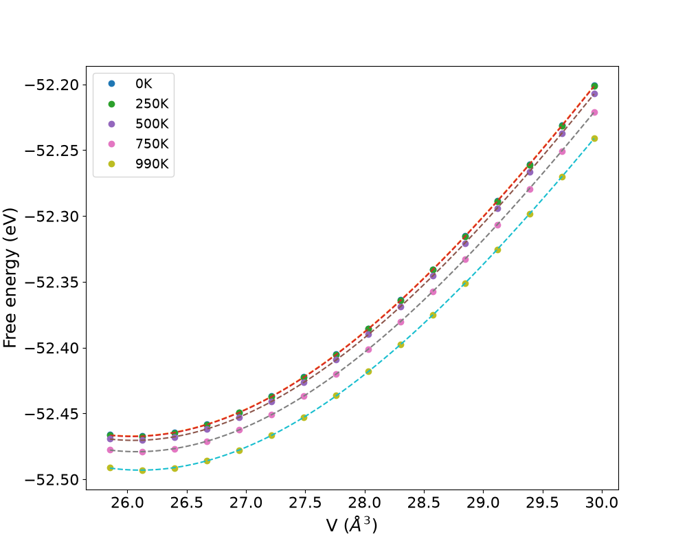
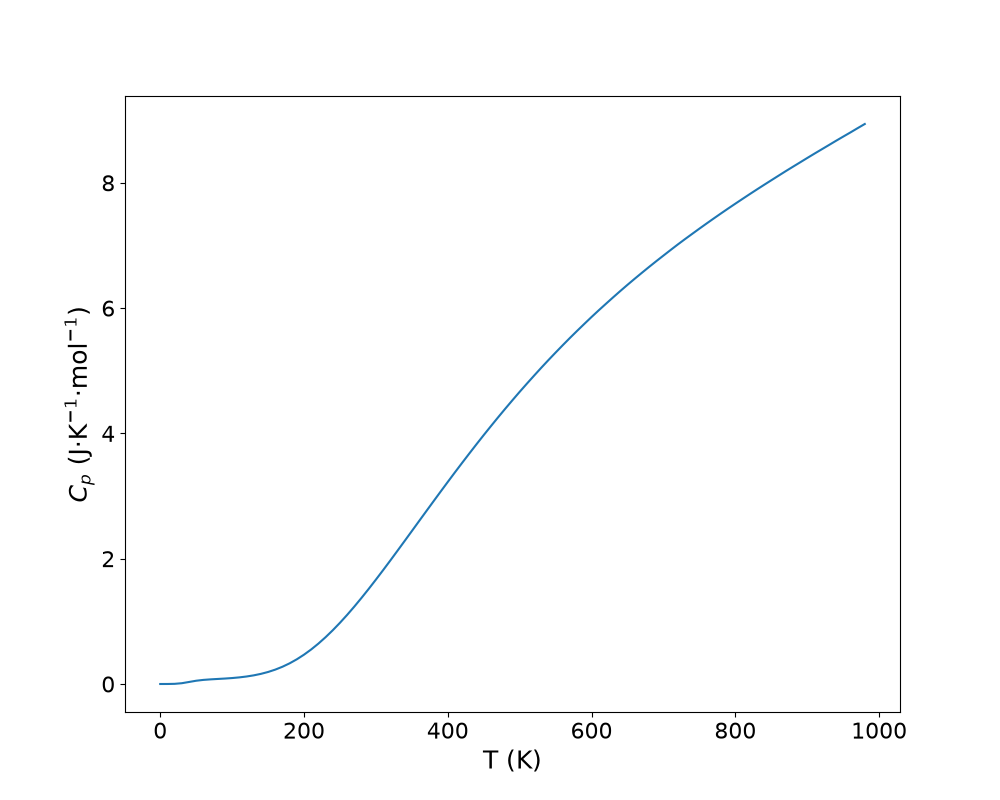

# Tutorial #3-FeRh (AFM phase) qha calculation
In this section, we will show how to calculate qha with magnon contributions using OstravaMag. As an example, we will use the AFM phase of FeRh with an fcc cell containing 2 magnetic Fe atoms.
First, make a directory called _*FeRh_tutorial*_ and copy the example OpenMX calculations into it
```
cp -r examples/QHA/FeRh/AFM/* FeRh_tutorial/
```
This contains calculations of the exchange constants for multiple volumes, as well as a file called "e-v.dat" containing the total energies from DFT calculations with the SCAN functional for multiple volumes that do not exactly correspond to the ones used for the magnon calculations.
Additionally, there is also a "fe-v.dat" file that contains the electronic free energies added to the total energies. When this file is found by OstravaMag, the magnon contributions are added on top of the electronic contributions, so the resulting qha calculations are carried out using both contributions. Furthermore, a file called "fe-v-OstravaMag.dat" is saved, which can be used as an input to phonopy to run qha with electronic, magnon and phonon contributions.
To run the calculation, use the following command
```
OstravaMag --compute_qha --directory_name_qha FeRh_tutorial/ \
--n_cells 2 --n_points 2000 --k_grid 25 25 25
```
It is important to specify here the number of cells in the supercell (we are using two primitive cells). We also want to use a large number of points in the density of states and a fine k-grid. The results are stored in the _*OstravaMag_results_qha*_ directory. We can check the quality of the fits of the free energy for a few temperatures in the _*qha_fits.png*_ file
  


  

We see that, given the range of volumes we have, we have managed to obtain a reasonable fit. The constant-pressure heat capacity should look like this
  


  

If you wish to see the results without the electronic contributions, just delete the _*fe-v.dat*_ file and re-run the calculations. It is important to set the same temperature range in the command line options
```
OstravaMag --compute_qha --directory_name_qha FeRh_tutorial \
--n_cells 2 --n_points 2000 --k_grid 25 25 25 \
--max_T 1000 --num_T 1001
```